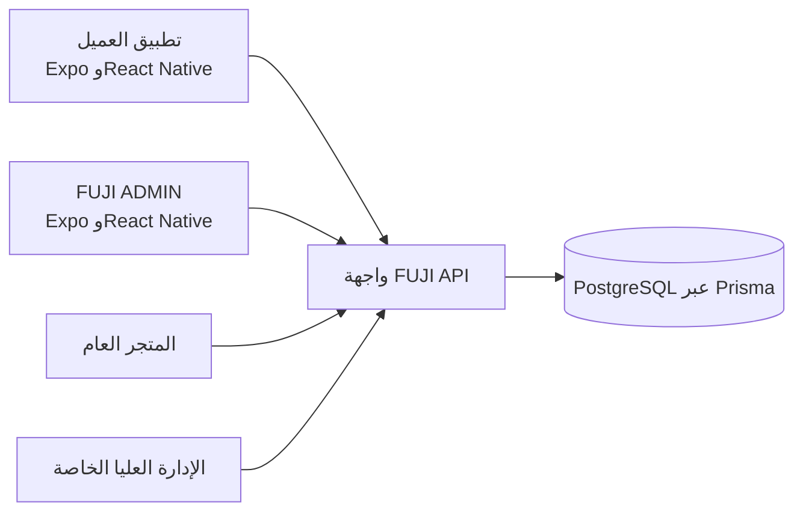

# دراسة حالة منصة مجموعة FUJI

## السياق

تجمع FUJI كتالوج المنتجات الهندسية وعمليات العملاء عبر متجر عام وتطبيق للعملاء وتطبيق للموظفين ولوحة إدارة عليا خاصة على الويب. بنيت تطبيقي الهاتف كعميلين منفصلين لجمهورين مختلفين.

## واجهات المنتج

- **المتجر العام:** استكشاف المنتجات وترشيح الكتالوج وفتح التفاصيل ومداخل حساب العميل.
- **تطبيق FUJI للعملاء:** الحساب وتصفح المنتجات والمفضلة والسلة والدفع وسجل الطلبات وشاشات الخدمات.
- **FUJI ADMIN:** لوحة للفريق ومهام مختارة لإدارة الكتالوج والعملاء واللوجستيات والمحتوى.
- **إدارة الويب العليا:** تحكم أوسع بمنصة الأعمال، مع بقاء الوصول والشيفرة خاصين.

## مسار العميل

يبحث العميل عن منتج ويطالع تفاصيله ويحفظه أو يضيفه إلى السلة ثم يكمل الطلب ويعود لمراجعة طلباته. وتتاح معلومات الشركة والمشاريع وطلبات الأسعار وقوائم الفحص وتتبع الشحنات والأدلة والمعارض والدعم عبر نموذج التنقل نفسه.

## مسار الفريق

يرى المشرف المسجل الوحدات التي تسمح بها صلاحياته. يتضمن التطبيق إنشاء المنتجات وتعديلها ورفع الصور والإدخال بالجملة وإدارة العلامات والفئات والعملاء والشحنات ومكتبة الأدلة وجدول المعارض والإعدادات وصلاحيات المشرفين الفرعيين. يركز تطبيق الهاتف على عمليات مختارة؛ وتبقى لوحة الويب أوسع واجهات الإدارة.

## البنية

تطبيق العملاء وتطبيق الإدارة عميلان منفصلان مبنيان باستخدام Expo SDK 54 وReact Native 0.81 وTypeScript. يتصلان بواجهة FUJI API للعمليات الموثقة ورفع الصور. يستخدم الخادم NestJS وPrisma مع PostgreSQL. ويرتبط الموقع العام وإدارة الويب الخاصة بالمنصة نفسها.

## قرارات هندسية

- فصل مهام العملاء والفريق ضمن تطبيقين وتنقلين مختلفين.
- تركيز مسار العميل على الكتالوج والسلة والحساب والخدمات.
- اشتقاق وحدات FUJI ADMIN من الدور والنطاق بدلاً من إظهار كل أدوات التحكم لكل موظف.
- إعادة استخدام واجهة API ورفع الصور كي تتعامل التطبيقات مع بيانات الأعمال نفسها المستخدمة عبر الويب.
- إبقاء المستودع التوثيقي دون شيفرة أو سجلات إنتاج أو وصول إلى الإدارة الداخلية.

## حالة النشر والحدود

لم يُنشر أي من التطبيقين على Google Play أو Apple App Store، ولا توجد روابط تنزيل عامة. لا تتاح شيفرة التطبيق الخاصة ولا الإدارة الداخلية من هذا المستودع. وإلى جانب لقطات الموقع العام، يتضمن المعرض أربع رسومات معاينة موضحة لواجهات التطبيقات، مستندة إلى الشيفرة وتستخدم بيانات اصطناعية. إنها رسومات تصورية وليست لقطات من تطبيقين يعملان فعلياً.

المتجر العام هو [fujihk.net](https://fujihk.net/). وجود الموقع لا يعني نشر التطبيقين على متاجر التطبيقات.
