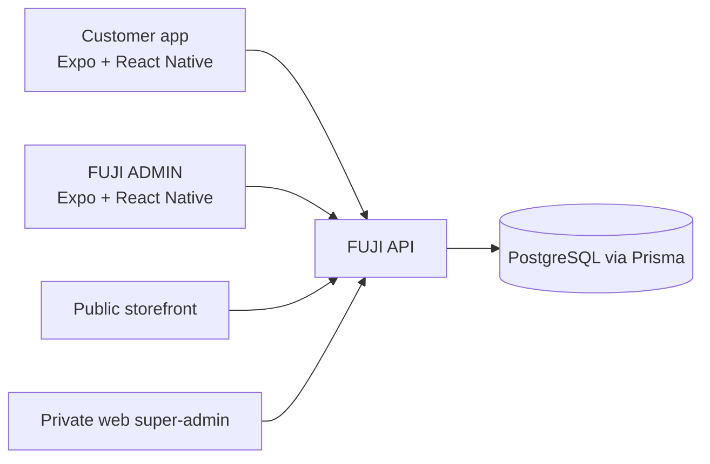

# FUJI Group platform case study

## Context

FUJI brings an engineering product catalogue and customer operations together across a public storefront, a customer mobile app, a staff mobile app and a private web super-admin surface. I built the two mobile applications as separate clients for two different audiences.

## Product surfaces

- **Public storefront:** product discovery, catalogue filters, product details and customer entry points.
- **FUJI customer app:** account, product browsing, wishlist, cart, checkout, order history and business-service screens.
- **FUJI ADMIN:** staff dashboard and selected catalogue, customer, logistics and content-management tasks.
- **Web super-admin:** broader controls for the business platform; internal access and source remain private.

## Customer workflow

A customer finds a product, reviews its details, saves it or adds it to a cart, checks out and returns to the app to review orders. Company information, projects, quotation requests, inspection checklists, logistics tracking, manuals, expo information and support are reachable from the same mobile navigation model.

## Staff workflow

A signed-in administrator sees modules based on configured permissions. The app includes product creation and editing, image uploads, bulk entry, brand and category management, customer controls, shipment management, manual-library editing, expo-schedule editing, settings and scoped sub-admin permissions. The mobile app focuses on selected staff operations; the web panel remains the broader administration surface.

## Architecture

The customer and admin apps are separate Expo SDK 54 / React Native 0.81 clients written in TypeScript. They call the shared FUJI API for authenticated operations and uploads. The backend is built with NestJS and Prisma over PostgreSQL. The public website and private web administration are connected to the same platform.

## Engineering decisions

- Differentiate customer and staff tasks with separate app shells and module navigation.
- Keep customer journeys focused on catalogue, cart, account and service screens.
- Derive FUJI ADMIN modules from role and scope data instead of showing every control to every staff account.
- Reuse the platform API and image-upload boundary so mobile actions use the same business data as the web clients.
- Keep the showcase source-free and avoid publishing production records or internal admin access.

## Release status and limitations

Neither mobile app is published on Google Play or the Apple App Store. There are no public download links. The private application source and internal administration remain unavailable from this repository. Alongside the public website captures, the gallery contains four labeled, source-based interface preview illustrations using synthetic data. They are concept artwork, not captures from running apps.

The public storefront is [fujihk.net](https://fujihk.net/). Website availability does not imply that either mobile app has been released.
